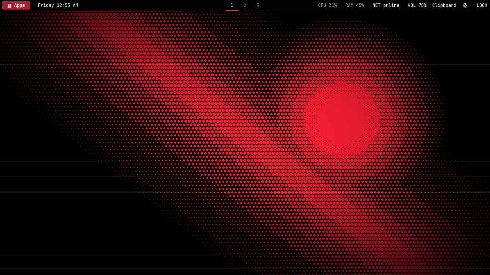
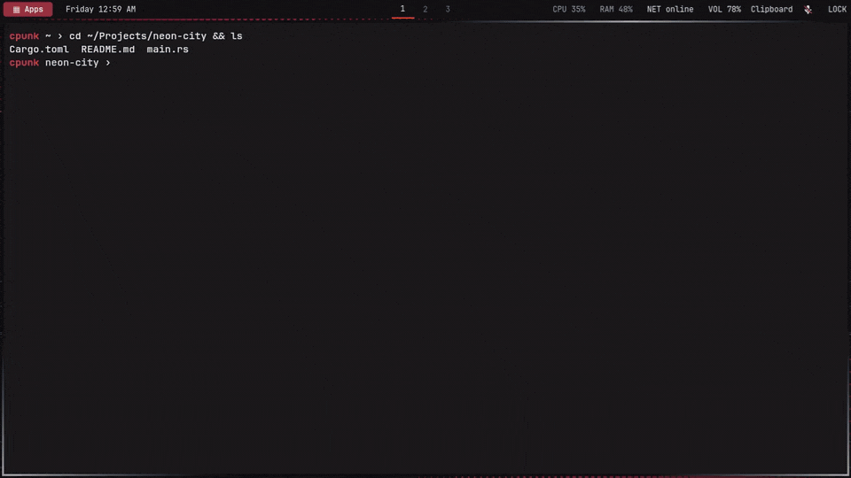
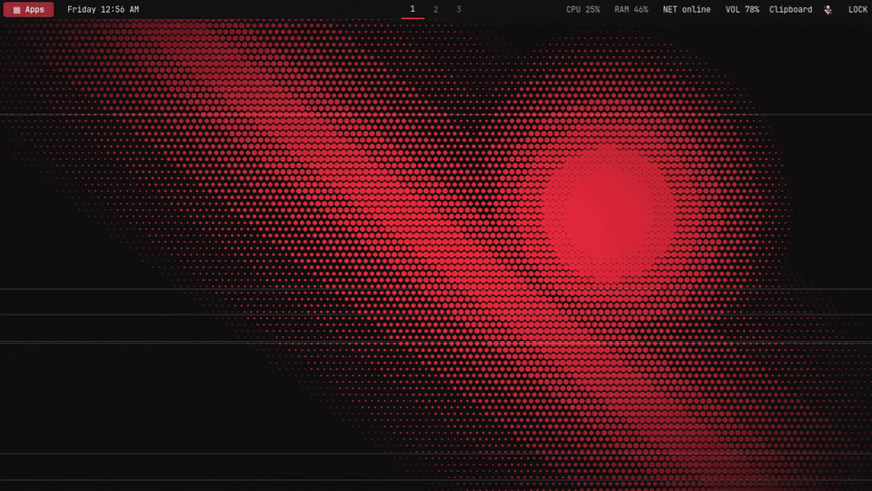
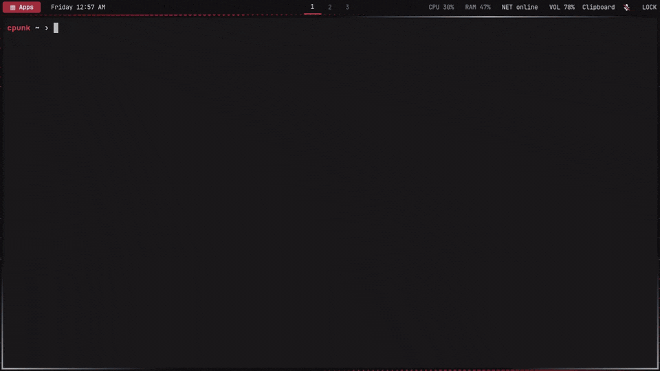
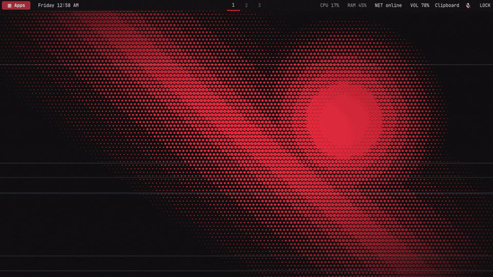

<div align="center">

# ▦ CpUnk on Ubuntu

**A red-on-black cyberpunk Hyprland desktop for Ubuntu 26.04: tiled windows, a Spotlight-style launcher, clipboard history, and one-key everything.**

[](#install)
[](https://hypr.land/)
[](#)
[](LICENSE)



[Showcase](#showcase) · [Install](#install) · [Walkthrough](#walkthrough) · [Shortcuts](#shortcuts) · [Customize](#customize) · [Recovery](#checks-and-recovery)

</div>

---

CpUnk-inspired Hyprland session with a tabbed Rofi launcher, black Waybar panel, square tiled windows, a matching Kitty terminal, and the original CpUnk wallpapers. GNOME stays available as a separate login, so you can switch back at any time.

This repository holds the configuration and integration scripts from my desktop. It's an Ubuntu adaptation, not a full Omarchy installation.

## Showcase

> [!NOTE]
> The recordings use original sample wallpapers, because this repository doesn't redistribute the upstream CpUnk artwork. After installing, you get the four upstream CpUnk wallpapers, and any images you add yourself.

### Launcher: one menu for everything

Press **Super + Space**, start typing, and hit **Enter**. **Ctrl + ←/→** flips between **Apps**, **Windows**, **System**, and **Wallpapers**.



### Tiling and workspaces

New windows tile on their own. Move focus with **Super + arrows**, rearrange with **Super + Shift + arrows**, resize with **Super + Ctrl + arrows**, and jump between workspaces with **Super + 1–9**.



### Clipboard history

**Super + Shift + V** shows your last 15 copies, text or images. **Enter** copies an item again, and **Shift + Delete** removes one.



### Wallpapers

Pick a wallpaper from the **Wallpapers** tab; your choice is kept for your next login. Images you drop into `~/.local/share/cpunk/wallpapers/` show up automatically.



## Install

Tested on Ubuntu 26.04, Hyprland 0.53.3, and an x86_64 NVIDIA desktop. Read through the scripts before you run them.

```bash
git clone https://github.com/yosefther/cpunk-ubuntu-dotfiles.git
cd cpunk-ubuntu-dotfiles
python3 install.py --install-deps --install-session
```

<details>
<summary><b>What the installer does</b></summary>

- Installs Ubuntu dependencies through `sudo apt-get` when `--install-deps` is supplied. Rofi 2.0 or newer with Wayland support is required, and `--install-deps` installs Ubuntu's package.
- Fetches the original CpUnk theme at the commit pinned in `upstream.json`.
- Downloads pinned official Walker and Elephant release archives and checks their SHA-256 hashes.
- Backs up each existing managed file under `~/.local/share/cpunk/backups/` before replacing it.
- Writes paths for your username, instead of assuming `/home/user`.
- Adds **CpUnk (Hyprland)** to the login screen with `--install-session`.
- Masks the package Waybar/Hyprpaper services for this user; the CpUnk session starts them directly, keeping them out of GNOME.

</details>

Already have the packages? Run `python3 install.py --install-session`. To install only the user files and register the login entry later, run `python3 install.py`.

The installer needs Python 3, Git, internet access, and an x86_64 machine for the pinned release binaries. Keep a separate GNOME login while you check your first full session.

Save your work and log out. At the login screen, choose your username, open the gear/session selector, pick **CpUnk (Hyprland)**, and sign in. Choose **Ubuntu** to go back to GNOME. The generic **Hyprland** entry doesn't use this repository's configuration.

## Walkthrough

Your first session, step by step. **Super** is the Windows-logo key.

1. **Log in.** Choose **CpUnk (Hyprland)** at the login screen. The black panel appears at the top: **Apps** on the left, workspaces in the middle, system stats and the **Clipboard** / **LOCK** buttons on the right.
2. **Open a terminal.** Press **Super + Enter** (or **Ctrl + Alt + T**). Kitty opens inside the `main` tmux session. Every terminal joins that same session, so a second terminal mirrors the first. For another shell, press **Ctrl + B** then **C** to open a tmux window.
3. **Launch an app.** Press **Super + Space**, type a few letters, and press **Enter**. Use **Ctrl + ←/→** to switch tabs and **Esc** to close.
4. **Arrange windows.** Open a second app and it tiles next to the first. **Super + arrow** moves focus, **Super + Shift + arrow** moves the window, and **Super + Ctrl + arrow** resizes it. **Super + V** floats it, **Super + F** makes it fullscreen, and **Super + Q** closes it.
5. **Use workspaces.** **Super + 2** jumps to workspace 2, and apps on workspace 1 keep running. **Super + Shift + 2** sends the focused window there and follows it. You can also click the numbers in the panel.
6. **Copy, paste, and reuse.** Press **Super + Shift + V** to see your last 15 copies. **Enter** copies an item again, **Ctrl + V** pastes it (**Ctrl + Shift + V** in the terminal), and **Shift + Delete** removes the highlighted item. **Clear clipboard history** at the bottom erases everything.
7. **Take a screenshot.** Press **Print Screen** and drag over an area. The image is copied to the clipboard and saved under `~/Pictures/Screenshots`.
8. **Change the wallpaper.** In the launcher, open the **Wallpapers** tab and press **Enter** on a preview.
9. **Lock or leave.** **Super + L** locks the screen. **Super + Shift + E** opens the menu; its **System** tab has log out, restart, and shutdown, each with a confirmation.

> [!TIP]
> Press **Super + K** at any time to open the [handbook](docs/HANDBOOK.md), which is installed at `~/.local/share/cpunk/handbook.html`. The idle timer locks the screen after ten minutes. Rebooting ends running tmux sessions; **Ctrl + B**, then **D** detaches without ending them.

## Shortcuts

| Shortcut | Action |
|---|---|
| <kbd>Super</kbd> + <kbd>Space</kbd> | Apps menu: search plus Apps, Windows, System, and Wallpapers tabs |
| <kbd>Super</kbd> + <kbd>Alt</kbd> + <kbd>Space</kbd> | Open the same Apps menu |
| <kbd>Ctrl</kbd> + <kbd>Alt</kbd> + <kbd>T</kbd> / <kbd>Super</kbd> + <kbd>Enter</kbd> | Kitty terminal, attached to the main tmux session |
| <kbd>Super</kbd> + <kbd>E</kbd> / <kbd>Super</kbd> + <kbd>B</kbd> | Files / Brave browser |
| <kbd>Super</kbd> + <kbd>arrow</kbd> | Focus another window |
| <kbd>Super</kbd> + <kbd>Shift</kbd> + <kbd>arrow</kbd> | Move the focused window |
| <kbd>Super</kbd> + <kbd>Ctrl</kbd> + <kbd>arrow</kbd> | Resize in 40-pixel steps |
| <kbd>Super</kbd> + <kbd>F</kbd> / <kbd>Super</kbd> + <kbd>V</kbd> | Fullscreen / floating mode |
| <kbd>Super</kbd> + left/right mouse drag | Move / resize a window |
| <kbd>Super</kbd> + <kbd>1</kbd>–<kbd>9</kbd> | Switch workspace |
| <kbd>Super</kbd> + <kbd>Shift</kbd> + <kbd>1</kbd>–<kbd>9</kbd> | Move a window to that workspace and follow it |
| <kbd>Super</kbd> + <kbd>Q</kbd> | Close the focused application |
| <kbd>Super</kbd> + <kbd>L</kbd> | Lock with Hyprlock |
| <kbd>Super</kbd> + <kbd>K</kbd> | Open the handbook |
| <kbd>Super</kbd> + <kbd>Shift</kbd> + <kbd>R</kbd> | Reload configuration |
| <kbd>Super</kbd> + <kbd>Shift</kbd> + <kbd>E</kbd> | Open the menu containing logout |
| <kbd>Super</kbd> + <kbd>Shift</kbd> + <kbd>V</kbd> | Clipboard history: copy an item again, or <kbd>Shift</kbd> + <kbd>Delete</kbd> to remove it |
| <kbd>Print Screen</kbd> | Select an area; copy the screenshot and save it under `~/Pictures/Screenshots` |
| <kbd>Ctrl</kbd> + <kbd>Alt</kbd> + <kbd>Shift</kbd> + <kbd>T</kbd> | Cairo/Ptyxis fallback terminal |

In the launcher, **Ctrl + ←/→** or **Ctrl + Tab / Ctrl + Shift + Tab** switches tabs, arrow keys select, **Enter** opens, and **Esc** closes. **Windows** jumps to a running app's workspace. **System** holds settings and session controls; log out, restart, and shutdown ask for confirmation.

Clipboard history starts with the CpUnk session and keeps the 15 most recent text or image items locally. Open it with **Super + Shift + V**, the panel's **Clipboard** button, or **Apps → System → Clipboard history**.

## Customize

The Rofi menu is a lightly glassy graphite Spotlight panel with a large search field, one vertical results list, clear application icons, signal-red selection, and persistent tabs. Settings uses the same near-black GTK palette with red navigation and control accents. The **System** tab includes Settings, Network, Sound, Files, Terminal, Help, and session controls; the panel's network and sound buttons use the same settings wrapper. GTK styling is saved in `~/.config/gtk-3.0/gtk.css` and `~/.config/gtk-4.0/gtk.css`.

| What | How |
|---|---|
| **Wallpaper** | Apps menu → Wallpapers. Choices are the upstream `Arcyx.png`, `Bxry2.png`, `Cryox3.png`, and `Draxo.png`, plus any PNG, JPG, JPEG, or WebP you add to `~/.local/share/cpunk/wallpapers/`. The selection is saved in `~/.config/cpunk/hyprpaper.conf`. Personal images stay local and aren't part of this repository. |
| **Keyboard** | Edit `input.kb_layout` in `~/.config/cpunk/hyprland.conf`. The snapshot uses `us`. |
| **Monitor** | The default is preferred resolution, automatic placement, scale 1. Adjust `monitor` for your displays. |
| **Browser** | **Super + B** expects an existing `brave-browser` installation, which this script doesn't install. Point the binding at `firefox` or another browser if needed. |
| **Panel** | Edit `~/.config/cpunk/waybar.json` and `waybar.css`. |
| **Theme overrides** | The `adapters/` files contain only the Ubuntu-specific additions; original theme styles are fetched from upstream. |

<details>
<summary><b>NVIDIA and rendering notes</b></summary>

GTK applications and Walker use Cairo rendering, and Walker also requests full redraws. These settings worked around NVIDIA rendering problems on the original machine, at some extra CPU cost. Kitty still uses its normal GPU renderer. Blur and animations are disabled.

`install.py` doesn't change Discord's acceleration preference. If Discord freezes, turn off Hardware Acceleration in Discord's settings and restart it. Existing Discord launcher overrides, shell histories, credentials, and application profiles aren't part of this repository.

</details>

## Checks and recovery

```bash
Hyprland --verify-config --config "$HOME/.config/cpunk/hyprland.conf"
hyprctl configerrors
hyprctl binds
nvidia-smi
```

Session component logs are under `~/.local/state/cpunk/`. The setup was checked in a nested preview and then used in a full login on the original machine; another computer still needs its own display, audio, networking, and lock checks.

To return to GNOME, log out through the CpUnk menu and select **Ubuntu** at login. To restore an overwritten file, copy it from your timestamped backup to the same relative path under your home. `manifest.json` records which managed paths existed before installation; newly created paths have no previous file to restore. Keep the backup local.

A staging check can use the existing pinned theme checkout without touching the active desktop:

```bash
python3 install.py --target-home /tmp/cpunk-staging \
  --upstream "$HOME/.local/share/cpunk/source" --skip-runtime
Hyprland --verify-config --config /tmp/cpunk-staging/.config/cpunk/hyprland.conf
```

## Credits

Original theme and artwork: [stannorbvb-cmd/cpunk](https://github.com/stannorbvb-cmd/cpunk), pinned to `c4d726bea9e6e4b3feb477c052e25bfcb2832ea4`.

Launcher and backend: [Walker](https://github.com/abenz1267/walker) 2.17.2 and [Elephant](https://github.com/abenz1267/elephant) 2.22.1. Desktop: [Hyprland](https://hypr.land/), [Waybar](https://github.com/Alexays/Waybar), and [Rofi](https://github.com/davatorium/rofi).

See [THIRD_PARTY.md](THIRD_PARTY.md) for how upstream assets are handled. The wallpapers in the showcase recordings are original and made for this README.
